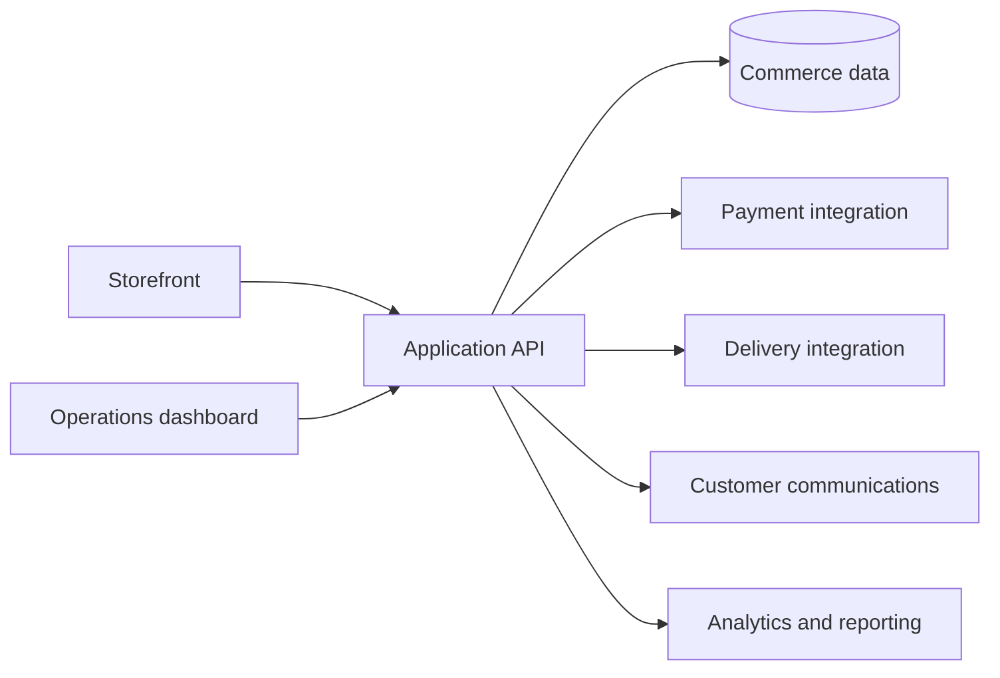
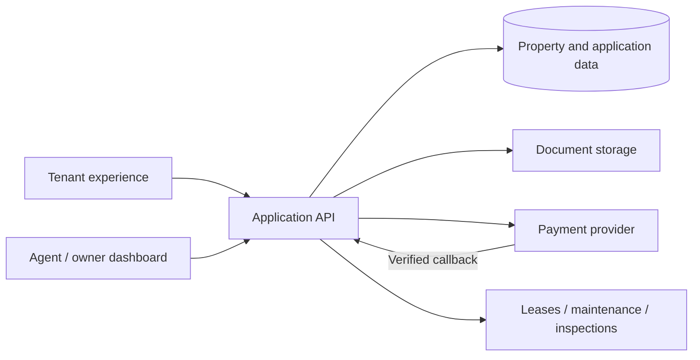

  
  <h3>Software Engineer · System Architecture · Product Engineering</h3>
  
From a business bottleneck to a working system: I design the workflows, build the APIs, connect the data, and shape the experience.

  
<a href="https://github.com/mafadilephaka">GitHub</a> · <a href="https://skybridge.fadimantech.co.za">SkyBridge</a>

---

## Selected work / 02 systems

| 01 / TRADEPULSE | 02 / SKYBRIDGE |
| :--- | :--- |
| **Commerce operations, intelligence & growth** | **A connected rental lifecycle** |
| Inventory, orders, storefront, customer insights and campaigns belong in one coherent operating workflow. | Applications, documents, approvals, payments and property operations should not live in disconnected inboxes. |
| **Domain:** E-commerce / business operations | **Domain:** Property technology / rentals |

> **Visual assets:** Add authentic screenshots to `assets/tradepulse-dashboard.png`, `assets/tradepulse-storefront.png`, `assets/skybridge-dashboard.png` and `assets/skybridge-application.png`. The README deliberately does not display missing or fabricated screenshots. Once added, uncomment the image blocks below.

---

## 01 — TradePulse

### Why manage five disconnected tools when one platform can connect your commerce operations?

**The problem.** A growing retailer may have a storefront in one place, stock records in another, marketing tools elsewhere, and customer history spread across services. The result is duplicate administration and difficulty answering basic questions: *Which products are profitable? What needs replenishing? Which customers return? Which campaigns lead to orders?*

**The alternatives.** Established platforms such as Shopify and WooCommerce provide mature commerce ecosystems, often with powerful extensions and integrations. Depending on a merchant's requirements, those extensions can introduce additional subscriptions, configuration work and fragmented reporting. This is a **fit and workflow** consideration—not a claim that these platforms lack analytics or are universally more expensive.

**The approach.** TradePulse is designed to connect a customer-facing storefront with operational tools and actionable business intelligence.

| Operational challenge | TradePulse approach | Intended business value |
| :--- | :--- | :--- |
| Stock changes are difficult to track | Product catalogue, inventory views and low-stock alerts | Earlier replenishment decisions |
| Orders and fulfilment need manual coordination | Order management and delivery-tracking workflows | More consistent operations |
| Sales data lacks context | Revenue, product, category and geographic analysis | Clearer merchandising decisions |
| Marketing and customer data are separated | Segmentation, promotions, email and messaging capabilities | More relevant outreach |
| Storefront discoverability needs attention | SEO-oriented product/category structure | Better foundations for organic discovery |

**Engineering lens.** The core challenge is not another dashboard: it is keeping storefront activity, orders, stock, customer records and downstream integrations coherent. That requires carefully designed API contracts, consistent data models, explicit state transitions and resilient integration boundaries.

**Architecture — conceptual, verify against deployed code:**

**Technology areas:** Angular / TypeScript, backend APIs, relational data, payment and courier integrations. Confirm current deployed versions and providers before publishing detailed implementation claims.

<!-- Add actual screenshot files first, then uncomment:

 

-->

**Why this approach?** TradePulse targets businesses that value a more connected operational workflow and customisable integration points. Established platforms may still be preferable when a merchant prioritises a broad third-party app ecosystem, ready-made themes or established managed hosting.

---

## 02 — SkyBridge

### From scattered rental paperwork to one connected property workflow.

**The problem.** Rental journeys often cross multiple people and tools: applicants send documents by email, agents coordinate viewings in chat, payments are reconciled separately, and owners ask for updates without a shared source of truth. Missing documents, unclear statuses and repeated follow-ups slow decisions.

**The alternatives.** Traditional agency workflows can be flexible but labour-intensive. Existing property-management products offer substantial functionality; the gap SkyBridge targets is a **connected, configurable application-to-tenancy process**, not a claim that competitors cannot handle applications, leases or payments.

**The approach.** SkyBridge connects property discovery, agency operations, rental applications, document handling, payment verification and post-lease management in a common workflow.

| Friction point | SkyBridge approach | Intended benefit |
| :--- | :--- | :--- |
| Applications arrive incomplete | Guided forms and required document uploads | More complete submissions |
| Agents receive unpaid applications | Payment-gated submission workflow | Clearer review eligibility |
| Status updates get lost | Application stages and role-based access | Better visibility for stakeholders |
| Lease and payment records are scattered | Digital lease, deposit and rent workflows | Less context switching |
| Maintenance issues lack continuity | Issue tracking, inspections and contractor workflows | Traceable property operations |

**A critical workflow decision:** an application should not enter the agency/agent review queue until the required fee is verified. The backend—not only the UI—must enforce that invariant. Payment callbacks must be validated, idempotent and linked to the correct application; unsuccessful or pending payments must not unlock submission.

**Architecture — conceptual, verify against deployed code:**

**Technology areas:** Angular, Django REST Framework, PostgreSQL, role-based workflows, document handling and payment integrations. Validate exact deployed infrastructure and feature status against the repository.

<!-- Add actual screenshot files first, then uncomment:

 

-->

**Why this approach?** The design emphasises a single, traceable rental journey, with business rules enforced at the API layer. Existing products may offer broader accounting, syndication or enterprise capabilities; SkyBridge's differentiation should be judged against a specific agency's workflow requirements.

---

## Engineering principles

| Think in workflows | Protect the boundaries | Make complexity usable |
| :--- | :--- | :--- |
| Model the full business process, not just isolated screens. | Treat permissions, payments and external callbacks as backend concerns. | Design interfaces around decisions people need to make. |

**Build systems that reduce friction—not just interfaces that look finished.**

Portfolio case studies describe product goals and architectural approaches. Feature availability, screenshots and production outcomes should be verified against the live applications before publication.
